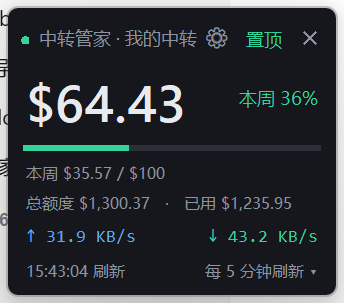
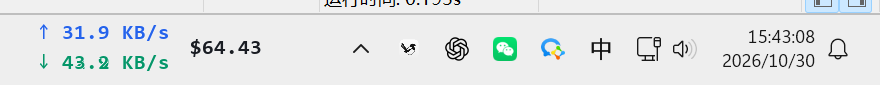
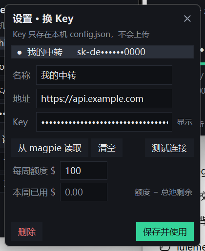

# 中转管家

给中转站（new-api / one-api 类接口）做的桌面小工具：**置顶浮窗看额度**，外加**实时网速**（Windows 放任务栏，macOS 放菜单栏）。

- 余额、周额度一眼可见，快用完时变琥珀 / 变红
- 任务栏条常驻，上传 / 下载实时刷新
- 托盘常驻、开机自启、换 Key、多账号切换







> macOS 有两个版本：
> - [`mac-native/`](mac-native/) — **Swift + SwiftUI 原生版**（推荐，无 Python 依赖，`./scripts/build-app.sh` 一键出 .app）
> - [`mac/`](mac/) — Python 版（rumps + tkinter），**已停止维护**，只作为原生版跑不起来时的退路
>
> 两者共用同一份 `~/.config/relay-balance/config.json`，可以随时切换。

## 功能

| 模块 | 说明 |
|---|---|
| 额度面板 | 无边框卡片，可置顶、可拖动、位置自动记忆；大字显示总池剩余，进度条按周额度算占用 |
| 任务栏条 | 透明底只留文字，贴在托盘左侧；上传/下载两行叠放；三列「网速 | 内存占用 | 余额·token」用竖线隔开；截图、任务栏重排后会自动抢回层级。任务栏停在上/下/左/右任意一边都跟着走，竖排时自动切成一行一项、单位缩短 |
| 周额度 | 本周已用 = 周额度 − 总池剩余，公司按周给池子补额度，补满即自动归零 |
| 按需刷新 | 只有今日 token 涨了才照刷新间隔去查余额；没在用就不打中转接口。读不到 magpie / CC Switch 用量时自动退回定时刷新，托盘里可关 |
| 托盘菜单 | 立即刷新、刷新间隔（30 秒 ~ 30 分钟）、夜间暂停、有用量才查余额、网速条开关与微调、用量统计、设置、检查更新、打开日志、退出 |
| 夜间暂停 | 21:00–08:30 不查额度（只停余额请求，网速 / token / 内存照常走本地统计），窗口可在 `config.json` 的 `night_from` / `night_to` 改 |
| 设置窗口 | 管理多组「名称 / 地址 / Key」，可测试连接；一键读 magpie 或 CC Switch 里已有的配置 |
| token 用量 | 面板与任务栏条显示今日消耗（每 5 秒刷新）；托盘「用量统计…」看今日 / 本周 / 本月、近 7 天、按月、模型拆分 |
| 剩余内存 | 面板显示可用内存与占用比例，超 80% 变琥珀、90% 变红；与 token 一起 5 秒刷新，可关 |
| 自动更新 | 启动 8 秒后查一次 GitHub，之后每 6 小时一次；有新版时面板标题栏出现绿色「可更新」，点一下 `git pull` 并自动重启 |
| 容错 | 查询失败 5 秒后自动补一次（只补一次）；任务栏条跟 explorer 一起失效时自动重挂；开机自启早于任务栏时先浮条兜底，5/10/20/40/60 秒退避重试 |
| 日志 | 写 `%LOCALAPPDATA%\relay-balance\app.log`，1MB 自动轮转；托盘 / 右键菜单「打开日志」直接定位 |
| 其他 | 单实例运行、开机自启、最小化到托盘、窗口位置持久化、配置原子写入（写一半崩了也不会丢） |

## 运行

需要 Windows 10/11 + Python 3.9 以上。

```bash
pip install pillow psutil pystray
python balance_widget.py
```

不想要黑框就用 `pythonw.exe`，或者直接双击 `start-widget.vbs`。

生成桌面 / 开始菜单快捷方式（需要 `pywin32`）：

```bash
pip install pywin32
python make_shortcut.py
```

## 代码结构

单文件涨到两千多行不好读，按职责拆成了几块，界面层只负责画，逻辑层不碰 Tk：

| 文件 | 职责 |
|---|---|
| `balance_widget.py` | 主面板 `Widget` + 启动入口、托盘菜单 |
| `rb_core.py` | 路径、`config.json` 读写、配色、格式化、网速计数 |
| `rb_providers.py` | magpie / CC Switch 凭据、余额接口（纯标准库，可单跑） |
| `rb_win.py` | Win32 窗口工具：圆角、任务栏度量、置顶 band、遮挡检测、托盘图标 |
| `rb_strip.py` | Tk 悬浮网速条（原生条挂不上时的退路） |
| `rb_settings.py` | 设置窗口（换 Key、周额度） |
| `rb_usage.py` | 用量统计窗口 |
| `taskbar_strip.py` | 真正的任务栏子窗口，纯 Win32 + GDI，不依赖 Tk |

想验证凭据和接口是否通，不用开界面：

```bash
python balance_widget.py --check
```

## 配置

首次运行会在同目录生成 `config.json`（已加入 `.gitignore`，不会上传）。参考 `config.example.json`。

```jsonc
{
  "provider": null,        // magpie 里的供应商 id；留空 = 自动取第一个可用供应商
  "interval": 600,         // 余额刷新间隔（秒）；有 token 变动才照这个间隔查
  "refresh_on_token": true, // 只在今日 token 有增长时才查余额（读不到用量日志时自动退回定时查）
  "night_pause": true,     // 夜间暂停查额度
  "night_from": 21,        // 21:00 起
  "night_to": 8.5,         // 次日 08:30 止（支持半小时）
  "accounts": [            // 也可以不用 magpie，自己填中转地址与 Key
    { "name": "我的中转", "base": "https://api.example.com", "key": "sk-xxx" }
  ],
  "active": "我的中转",
  "week_quota": 100.0,     // 每周额度
  "net_panel": true,       // 面板里显示上传/下载
  "bar_mode": "taskbar",   // taskbar 贴任务栏 / float 悬浮条 / off 关闭
  "bar_transparent": true, // 透明底，只留文字
  "bar_stack": true,       // 上传下载两行叠放（关掉是单行横排）
  "bar_dx": 0,             // 任务栏条水平微调
  "bar_dy": 0
}
```

界面里能改的都不用手改文件：右键面板或任务栏条就是全部菜单。

## 数据来源

余额走 new-api 的计费接口（`Authorization: Bearer <key>`）：

- `GET /v1/dashboard/billing/subscription` → `hard_limit_usd` 总额度
- `GET /v1/dashboard/billing/usage` → `total_usage`（单位是美分）

剩余 = 总额度 − 累计已用。

**注意**：`usage` 接口不认 `start_date` / `end_date`，只返回累计值，所以「本周已用」拿不到服务端数据，本项目按「周额度 − 总池剩余」反推。总池比周额度多时按 0 显示；扣成负数时百分比超过 100%，进度条满格变红。

网速用 `psutil.net_io_counters(pernic=True)` 求差，排除 loopback / teredo / isatap，避免本地代理把流量算两遍。

## 更新

程序自己查 GitHub：拿本机 `.git` 里的 HEAD 和 `brookLyn1102/relay-balance` 的 `main` 比对。走的是 compare 接口，一次请求就带回「落后几个提交」和最新提交的标题、时间、链接，不需要 token（匿名额度每小时 60 次，够用）。

- 启动 8 秒后自动查一次，之后每 6 小时一次；夜间暂停时段不查
- 有更新时面板标题栏出现绿色「可更新」，托盘菜单变成「↑ 更新到 abc1234」
- 点它执行 `git pull --ff-only`，成功就自动重启；本地有未提交改动或分叉时会失败并给出原因，不会硬来
- 目录不是 git 副本（直接拷出来的文件夹）时，点了只会打开 GitHub 页面

macOS 原生版也查同一套：`scripts/build-app.sh` 会把当前提交号写进 `Info.plist` 的 `RelayCommit`。`.app` 自己没法拉代码，点「可更新」打开的是对应提交页，`git pull` 之后重新跑一次构建脚本即可。

## 实现备忘

Win11 的任务栏是 XAML 合成层。最初把无边框 Tk 窗口贴在任务栏上，靠每秒扫 Z 序把被压下去的抢回来——鼠标悬停任务栏图标时任务栏会重排层级，条就会闪一下消失。现在的做法照 TrafficMonitor 来：

1. `taskbar_strip.py` 用纯 Win32 `CreateWindowEx(WS_CHILD)` + `SetParent(Shell_TrayWnd)`，把自己变成任务栏的子窗口
2. GDI 双缓冲自绘（`CreateCompatibleBitmap` + `BitBlt`），跑在独立消息线程里，不占 Tk 主循环
3. `WS_EX_LAYERED` + 透明色 key 抠底，文字颜色跟任务栏明暗（`SystemUsesLightTheme`）走

子窗口不参与顶层 Z 序竞争，所以不需要任何「抢置顶」逻辑。同样的路子 Tk 走不通：`SetParent` 后父句柄会被 Tk 自己清回 0，补上 `WS_CHILD` 虽然能挂住，但会被 XAML 内容层盖住。

token 用量只读本地日志（magpie 的 `~/.config/magpie/routing/*.jsonl` + CC Switch 的 sqlite），5 秒一轮必须做增量：按字节偏移只消费新增的行，整行没写完就留到下一轮。

容错这块有三处坑，都做了兜底：

- `config.json` 用临时文件 + `os.replace` 原子替换，写一半断电也不会只剩半个 JSON
- 任务栏条挂在 `Shell_TrayWnd` 底下，explorer 重启时它会跟着旧任务栏一起销毁——每 3 秒用 `IsWindow` + `GetParent` 自检，失联就重建
- 开机自启可能比任务栏先起来，挂载失败先用悬浮条顶上，再按 5/10/20/40/60 秒退避重试

日志统一写 `%LOCALAPPDATA%\relay-balance\app.log`（1MB 轮转）。原先几十处 `except Exception: pass` 是排查问题最大的障碍，现在关键路径都会留一行。

## 许可

MIT
